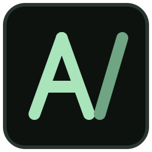

<p align="center">
  
</p>

<h1 align="center">Atlas Engine</h1>

<p align="center">
  A desktop app for training, comparing and exporting machine-learning models,<br>
  built around the 830-entry <em>ML, DL &amp; Computer Vision Algorithms Atlas</em>.
</p>

<p align="center">
  <a href="LICENSE"></a>
</p>

## Download

Get the Linux AppImage or the Windows zip from [Releases](https://github.com/Aruneshw/atlas-engine/releases).

## How it works

The packaged app holds only the interface. When you press Train, a terminal panel inside the app:

1. Probes CPU, RAM, disk, GPU, driver and CUDA version.
2. Plans the job: CPU or GPU, threads, batch size, a RAM estimate.
3. Installs only the libraries that algorithm needs into a managed runtime, using a bundled `uv`.
4. Confirms the runtime can reach the planned device, and falls back to CPU if it can't.
5. Trains in a separate process, with logs, Cancel and error handling.

Runtimes live in `~/.local/share/atlas-engine/envs` on Linux and `%LOCALAPPDATA%\AtlasEngine\envs` on Windows.
They must stay on an internal disk, because exFAT can't hold Python environments. The run history can move to
an external drive through **Runs folder**.

## Results you can trust

Every table-based classification and regression run checks itself, and the warnings appear beside the results.

- **Leak scan.** Finds columns that give the answer away, including pairs that rebuild the target only when combined.
- **Clean time splits.** Rows with the same timestamp always stay on one side of a split or fold.
- **Column picker.** Untick any column on the Dataset page that you would not know when making a prediction.
- **Score to beat.** Each run reports what always guessing the average or the commonest class would score.
- **95% range.** Each score has a bootstrap range. Models whose ranges overlap are tied.
- **Coverage.** Warns about test rows repeated from training, and categories training never saw.
- **Refused forecasts.** A time column with repeated values is many series mixed together, so it cannot be forecast as one.

Choose between models with the validation score, and read the test score last. Scan and ranges cover mistakes that can be detected,
but only you can say whether a column will truly be available at prediction time.

## Control the hardware

The Configure page and the Train page both have CPU, RAM and GPU limits. On the Train page they work while the model trains.

| Control | What it does | When it is reached |
|---|---|---|
| **GPU accelerator** | Appears when an NVIDIA GPU is found. During a CPU run it restarts training on the GPU (progress so far is lost) | Greyed out for algorithms that run on the CPU only |
| **CPU** | A share of the whole machine | Training runs slower |
| **RAM** | A size in GB | Training slows while file cache is dropped and memory is swapped out |
| **GPU** | A share of GPU time | Work is spaced out, so training runs slower |
| **VRAM** | GPU memory for PyTorch models, set before a run | Batches shrink to fit |

A limit slows training down and never stops it. If the machine itself is nearly out of memory, training pauses and carries on
by itself when memory is free. A GPU that runs out of memory restarts with a smaller batch, and finally on the CPU.

A machine with no swap has nowhere to put memory above the RAM limit, and a job held below what it needs would all but stop.
So on those machines the limit rises in small steps, and the Train page says when that happens. With swap enabled the limit holds.

CPU threads are chosen from the limit when a run starts, so raising the limit mid-run only helps up to that thread count.
Live limits need Linux with systemd and cgroups v2. Elsewhere the CPU limit becomes a thread count and the others are unavailable.

## Layout

| Path | What it is |
|---|---|
| `atlas_engine/` | Desktop UI (PySide6), hardware probe, runtime setup. Needs nothing but PySide6 |
| `atlas_worker/` | Training, prediction and export. Runs inside the managed runtime |
| `atlas_worker/registry.py` | Which atlas entries can train, their settings, and their adapters |
| `atlas_worker/runtime_pins.py` | Exact library versions |
| `atlas_engine/data/catalog.json` | All 830 entries, parsed from the PDF by `tools/parse_atlas.py` |
| `atlas_engine/data/verified.json` | What really passed `tools/smoke_test.py`. The UI reads this |

## What you can load

Use **look in** to start from any connected drive, or drop a file or folder onto the window.

**Tables:** CSV, TSV, PSV, TXT, DAT, XLSX, XLSM, XLS, XLSB, ODS, JSON, JSONL, Parquet, Feather, Arrow, ORC, HDF5, XML, HTML, Stata, SAS, SPSS,
SQLite, NPY, NPZ, and gz, bz2, xz or zip around them. Separators and text encodings are detected. A plain `.txt` becomes one row per line.
Pickle files are refused, because opening one can run code.

**Folders:**

| Dataset | Layout |
|---|---|
| Images, audio or video by class | one subfolder per class |
| Images for generation or embeddings | any folder of images |
| Object detection (YOLO) | `images/` and `labels/`, with optional `data.yaml` and train/val subfolders |
| Object detection (COCO) | images plus a COCO annotation `.json` |
| Segmentation | `images/` and `masks/`, matched by file name; each mask value is one class |
| Graph | `nodes.csv` (id, numeric features, label) and `edges.csv` (source, target) |

Reinforcement learning needs no dataset: pick a simulated environment.

## Add an algorithm

Add one line to `registry.py`. A scikit-learn-style estimator needs no other code:

```python
add(25, {R: sk("some_library:SomeRegressor")}, [ALPHA], groups=("core", "some_group"))
```

Then run the smoke test for it, which also records whether it exports to ONNX:

```bash
~/.local/share/atlas-engine/envs/cpu/bin/python tools/smoke_test.py ~/.cache/atlas-smoke 25
```

## Run from source

```bash
python3 -m atlas_engine        # needs PySide6
```

## Test

```bash
tools/smoke_test.py            # every algorithm: train, predict, export (run with the runtime's Python)
python3 tools/ui_walkthrough.py /tmp/shots   # the whole UI, offscreen, with real training
python3 tools/limits_walkthrough.py /tmp/shots  # hardware limits and the GPU accelerator, changed during real runs
tools/test_evaluation.py /tmp/work   # known-answer tests for splits, leak scan and scores (run with the runtime's Python)
atlas-engine --selftest        # quick check of a packaged build
atlas-engine --selftest-train  # real setup, training and export from a packaged build
```

## Build

**Linux:** `tools/build_appimage.sh` builds `dist/Atlas_Engine-x86_64.AppImage` in an Ubuntu 22.04 container.

`tools/release.sh` builds both packages and tests them.

**Windows:** `tools/build_exe_wine.sh` builds `dist/Atlas_Engine-windows-x64.zip` on Linux with Wine in a container.
On Windows, use `tools/build_windows.ps1`, or the `build` GitHub Actions workflow, which builds both packages.

To check a Windows build on a real PC, run `atlas-engine.exe --selftest-train`, then read
`%LOCALAPPDATA%\AtlasEngine\selftest_result.txt`. Wine can't do this check, because Wine 9 can't import NumPy.

## License

[MIT](LICENSE). This covers the code in this repository. The bundled JetBrains Mono fonts are under the SIL Open Font
License. Libraries the app downloads when you train keep their own licenses: Ultralytics YOLO models, for example, are
AGPL-3.0, which matters if you ship a product built on them.
